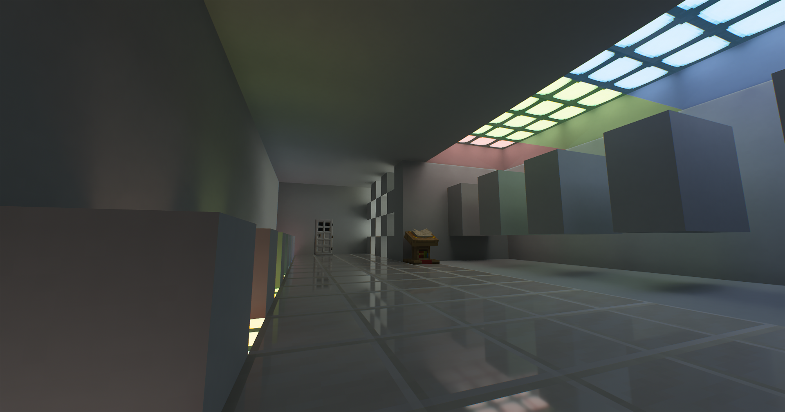
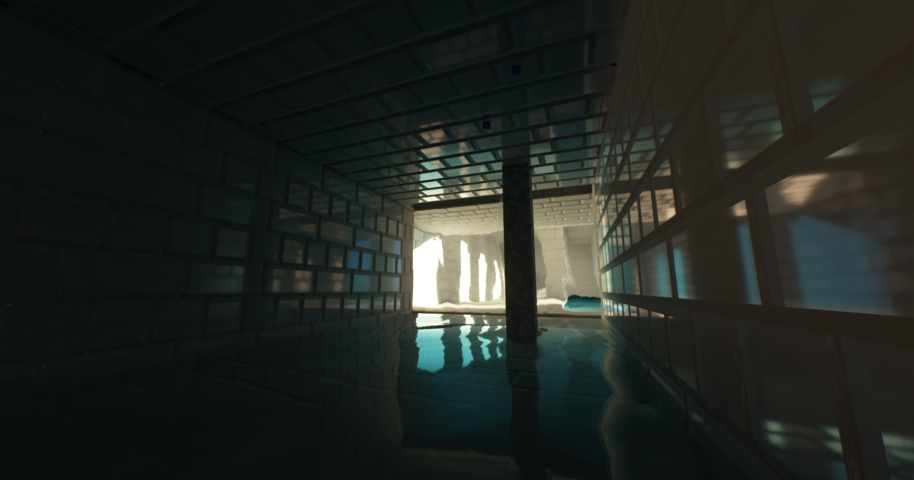
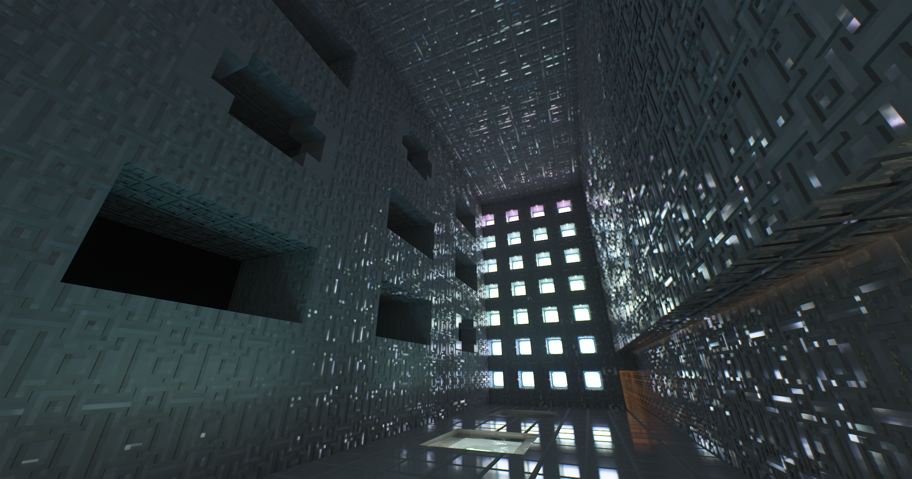

# Heliopause

**Real-time path-traced lighting for Minecraft · Maintained by [LycanW](https://github.com/LycanW)**

Heliopause continues [Zephyr Starlight](https://github.com/Kirilpro6284/zephyr-starlight)
by **Kirilpro6284**, with Intel compatibility fixes, revised lighting reconstruction,
and English and Simplified Chinese shader settings.

[Releases](https://github.com/LycanW/heliopause/releases) ·
[Report an issue](https://github.com/LycanW/heliopause/issues) ·
[Changelog](Changelog.md)

> **v0.3.0:** the native Falcor-based SVGF replacement has completed
> controlled validation on Intel Arc A770 for static opaque scenes, camera motion,
> large lighting changes and representative lifecycle settings. Per-object motion
> and other GPUs remain unqualified. See [known limitations](KNOWN_ISSUES.md) and
> [implementation notes](DENOISING.md).

## Features

- Path-traced diffuse lighting, multi-bounce reflections and sunlight shadows.
- Geometry-aware ray intersections and a sparse irradiance cache for indirect light.
- Falcor-based SVGF diffuse and specular denoising with NRD-inspired history
  and reflection handling, labeled **SVGF (NRD-style)** in settings.
- Mirror virtual-surface reconstruction, separate mirror history control, and
  importance sampling for reflected sunlight in the irradiance cache.
- LabPBR normal and specular maps, parallax occlusion mapping (POM), and integrated
  materials for vanilla textures. Resource-pack material values take precedence.
- Physical sky, water refraction and caustics, volumetric light and subsurface scattering.
- Temporal antialiasing and upscaling, bloom, exposure, depth of field and motion blur.
- Four quality profiles and English / Simplified Chinese settings.

See [Denoising integration notes](DENOISING.md) for signal inputs, controls and memory costs.

## Compatibility and installation

The development target is **Minecraft 26.3, Iris 1.11.7,
and Intel Arc A770 on Windows**. The replacement has been compiled and loaded on this target; other GPU,
driver and Minecraft combinations have not been qualified either. Iris must provide SSBO and custom-image
support. OptiFine and macOS are unsupported; Distant Horizons and Voxy integration
are not implemented.

Download `Heliopause-v0.3.0.zip` from [Releases](https://github.com/LycanW/heliopause/releases/tag/v0.3.0), place it in Minecraft's
`shaderpacks` directory and select it in Iris. A shaderpack ZIP must contain
`shaders/` directly at its root. For a source checkout, use the directory containing
this README and `shaders/` as the pack root.

A LabPBR resource pack is optional, but normal, height and custom specular effects
require matching material textures. For POM, set **Terrain > Parallax Occlusion
Mapping > Texture Resolution** to the resource pack's resolution; the default is
16. Height data comes from the normal texture's alpha channel.

## Quality profiles

New installations and reset options use **Balanced**. Normal and specular mapping
are enabled in every profile; POM is enabled from Balanced upward.

| Profile | Internal render scale | Diffuse / reflection / shadow samples | Reflection bounces | POM steps |
|---|---:|---:|---:|---:|
| Performance | 75% | 1 / 1 / 1 | 1 | Off |
| Balanced (default) | 100% | 1 / 1 / 2 | 3 | 32 |
| High | 100% | 1 / 2 / 2 | 4 | 64 |
| Ultra | 100% | 2 / 4 / 4 | 6 | 128 |

Diffuse and reflections run at full internal resolution. Profiles also adjust
cache sampling, denoising, volumetrics and camera effects. Performance uses three
SVGF spatial passes; the other tiers use five. These tiers describe rendering
work, not guaranteed frame rates.

Saved shader options override defaults. Select a profile explicitly or reset
options after upgrading. Material resolution, POM depth, scene capture and memory
capacities remain independently adjustable.

## Gallery

Screenshots supplied by LycanW, captured on October 25, 2026. They illustrate
development scenes and material effects, and predate the final v0.3.0 fixes.
They are not a comparison or validation capture of the release build.

## Current limitations

This is an experimental shaderpack. Shadow-placement accuracy remains under
investigation. The denoiser currently reconstructs camera motion for static geometry;
independent entity motion, animated geometry and moving reflected objects need
further work. See [known issues](KNOWN_ISSUES.md) before reporting a problem.

Include Minecraft / Iris versions, GPU and driver, selected profile, resource
pack, and a reproducible scene when opening an issue in
[this repository](https://github.com/LycanW/heliopause/issues).

## Credits and licenses

- **LycanW** — Heliopause maintenance, compatibility fixes and subsequent changes.
- **[Kirilpro6284](https://github.com/Kirilpro6284)** — original Zephyr Starlight.
- **[NVIDIA Falcor](https://github.com/NVIDIAGameWorks/Falcor)** — SVGF foundation.
- **[SVGF authors](https://research.nvidia.com/labs/rtr/publication/schied2017spatiotemporal/)**
  and **[NRD](https://github.com/NVIDIA-RTX/NRD)** — published reconstruction methods and design guidance.
- **[lucysir / kadir014](https://github.com/kadir014)** — blue-noise sampling.
- **[jbritain](https://github.com/jbritain)** — upstream AMD support and blue-noise texture.
- **[agentclone8](https://github.com/agentclone8)** — BRDF function.
- **[sixthsurge](https://github.com/sixthsurge)** — debug text rendering.
- **[Player2950 / ArslanShakirov](https://github.com/ArslanShakirov)** — playtesting.

The original shaderpack and Heliopause changes retain **[CC BY-NC-SA 4.0](LICENSE)**.
Falcor-derived SVGF sources retain their **[BSD-3-Clause license](THIRD_PARTY/Falcor-LICENSE.txt)**
and copyright notices. See [source provenance](THIRD_PARTY/Falcor.md) for the fixed
revision, adapted files and Heliopause extensions. The replacement contains no
NRD SDK shader kernels.
